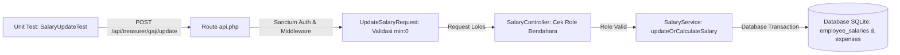

# PANDUAN LENGKAP & BEDAH KODINGAN UNIT TEST GAJI BENDAHARA (FR-TRS-01)
**Project PBL:** Joglo 66 Web  
**Branch Ujian:** `praktikum-lisan-huda`  
**File Testing:** `tests/Unit/Services/Treasure/SalaryUpdateTest.php`  
**Perintah Menjalankan:** `php artisan test`

---

## DAFTAR ISI
1. [Ringkasan Test Suite & Fitur](#1-ringkasan-test-suite--fitur)
2. [Tabel Hubungan Antar File & Arsitektur](#2-tabel-hubungan-antar-file--arsitektur)
3. [Kode Lengkap SalaryUpdateTest.php (Versi Final Bebas Error)](#3-kode-lengkap-salaryupdatetestphp-versi-final-bebas-error)
4. [Bedah Kode Baris per Baris: Setup Awal (setUp & Properties)](#4-bedah-kode-baris-per-baris-setup-awal-setup--properties)
5. [Bedah Kode Baris per Baris: TC-TRS-01.1 (Nominal Valid & Akses Bendahara)](#5-bedah-kode-baris-per-baris-tc-trs-011-nominal-valid--akses-bendahara)
6. [Bedah Kode Baris per Baris: TC-TRS-01.2 (Nominal Negatif Ditolak Validasi)](#6-bedah-kode-baris-per-baris-tc-trs-012-nominal-negatif-ditolak-validasi)
7. [Bedah Kode Baris per Baris: TC-TRS-01.3 (Akses Non-Bendahara Ditolak 403)](#7-bedah-kode-baris-per-baris-tc-trs-013-akses-non-bendahara-ditolak-403)
8. [Bedah Kode Baris per Baris: TC-TRS-01.4 (Pembatalan Form & Data Tidak Berubah)](#8-bedah-kode-baris-per-baris-tc-trs-014-pembatalan-form--data-tidak-berubah)
9. [Tanya Jawab Kritis Dosen: "Apa Gunanya & Kalau Tidak Ada Ini Kenapa?"](#9-tanya-jawab-kritis-dosen-apa-gunanya--kalau-tidak-ada-ini-kenapa)

---

## 1. RINGKASAN TEST SUITE & FITUR

| Kode TC | Modul | Deskripsi Skenario | Expected Result |
| :--- | :--- | :--- | :--- |
| **TC-TRS-01.1** | FR-TRS-01 | Berhasil memperbarui nominal gaji saat nominal valid (`>= 0`) & diakses Bendahara. | HTTP 200 OK, JSON success, DB terupdate nominal baru |
| **TC-TRS-01.2** | FR-TRS-01 | Gagal memperbarui nominal gaji saat nominal negatif (`< 0`, mis. -1). | HTTP 422 Unprocessable, error `amount_paid`, DB tidak berubah |
| **TC-TRS-01.3** | FR-TRS-01 | Gagal memperbarui nominal saat diakses peran non-Bendahara (mis. Tenant). | HTTP 403 Forbidden (`Akses ditolak.`), DB tidak berubah |
| **TC-TRS-01.4** | FR-TRS-01 | Membatalkan pembaruan nominal gaji saat Bendahara menekan tombol Batal. | Proses batal, DB tetap nominal awal, GET data tetap nominal lama |

---

## 2. TABEL HUBUNGAN ANTAR FILE & ARSITEKTUR

Alur eksekusi saat endpoint dipanggil:


* **Route:** `routes/api.php` (`Route::prefix('treasurer')->post('/gaji/update')`)
* **Request Validation:** `app/Http/Requests/Treasure/UpdateSalaryRequest.php`
* **Controller:** `app/Http/Controllers/Treasure/SalaryController.php`
* **Service:** `app/Services/Treasure/SalaryService.php`
* **Models Terkait:**
  * `User`: Autentikasi & pengecekan role (`treasurer` vs `tenant/worker`).
  * `Employee`: Master data karyawan (nama, posisi, gaji pokok).
  * `EmployeeSalary`: Transaksi gaji bulanan karyawan (`amount_paid`, `bonus`, `deduction`).
  * `Expense`: Catatan pembukuan kas pengeluaran operasional.
  * `Field`: Relasi dummy lapangan untuk entri expense.

---

## 3. KODE LENGKAP SALARYUPDATETEST.PHP (VERSI FINAL BEBAS ERROR)

```php
<?php

namespace Tests\Unit\Services\Treasure;

use App\Enums\GeneralStatus;
use App\Enums\UserRole;
use App\Models\Employee;
use App\Models\EmployeeSalary;
use App\Models\Expense;
use App\Models\Field;
use App\Models\User;
use Illuminate\Foundation\Testing\Concerns\InteractsWithDatabase;
use Illuminate\Foundation\Testing\Concerns\MakesHttpRequests;
use Illuminate\Testing\TestResponse;
use Tests\TestCase;

/**
 * @mixin \Illuminate\Foundation\Testing\TestCase
 * @mixin MakesHttpRequests
 * @mixin InteractsWithDatabase
 */
class SalaryUpdateTest extends TestCase
{
    use InteractsWithDatabase;
    use MakesHttpRequests;

    /**
     * @var User
     */
    protected $treasurer;

    /**
     * @var Field
     */
    protected $field;

    /**
     * @var Employee
     */
    protected $employee;

    /**
     * @var Expense
     */
    protected $expense;

    /**
     * @var EmployeeSalary
     */
    protected $salary;

    protected function setUp(): void
    {
        parent::setUp();

        // 1. Siapkan user bendahara
        /** @var User $treasurer */
        $treasurer = User::factory()->create([
            'role' => UserRole::TREASURER->value,
        ]);
        $this->treasurer = $treasurer;

        // 2. Siapkan data lapangan (dibutuhkan relasi expense di SalaryService)
        /** @var Field $field */
        $field = Field::factory()->create();
        $this->field = $field;

        // 3. Siapkan data karyawan aktif
        /** @var Employee $employee */
        $employee = Employee::create([
            'name' => 'Budi Santoso',
            'position' => 'Staff Operasional',
            'base_salary' => 2000000,
            'join_date' => '2026-01-01',
            'status' => GeneralStatus::ACTIVE->value,
        ]);
        $this->employee = $employee;

        // 4. Siapkan data pengeluaran (expense) awal
        /** @var Expense $expense */
        $expense = Expense::create([
            'fk_field_id' => $this->field->id,
            'fk_user_id' => $this->treasurer->id,
            'name' => 'Gaji '.$this->employee->name,
            'category' => 'Gaji',
            'quantity' => 1,
            'unit_price' => 2000000,
            'expense_date' => '2026-01-01',
            'generate_at' => '2026-01-01',
        ]);
        $this->expense = $expense;

        // 5. Siapkan data gaji awal karyawan (periode Januari 2026: Rp 2.000.000)
        /** @var EmployeeSalary $salary */
        $salary = EmployeeSalary::create([
            'fk_employee_id' => $this->employee->id,
            'fk_expense_id' => $this->expense->id,
            'amount_paid' => 2000000,
            'period_month' => 'january',
            'period_year' => 2026,
            'payment_date' => '2026-01-15',
            'bonus' => 0,
            'deduction' => 0,
            'notes' => 'Gaji Pokok Awal',
        ]);
        $this->salary = $salary;
    }

    /**
     * TC-TRS-01.1
     * Menguji apakah berhasil memperbarui nominal gaji saat nominal valid (>= 0) dan diakses oleh Bendahara.
     */
    public function test_tc_trs_01_1_berhasil_memperbarui_nominal_gaji_saat_nominal_valid_dan_diakses_bendahara(): void
    {
        $payload = [
            'employee_id' => $this->employee->id,
            'bulan' => 1, // Januari
            'tahun' => 2026,
            'amount_paid' => 2500000, // Valid (>= 0)
            'bonus' => 100000,
            'deduction' => 0,
            'notes' => 'Bonus performa lembur',
        ];

        /** @var TestResponse $response */
        $response = $this->actingAs($this->treasurer, 'sanctum')
            ->postJson('/api/treasurer/gaji/update', $payload);

        // Assert HTTP 200 OK & response JSON sesuai spesifikasi
        $response->assertStatus(200)
            ->assertJson([
                'success' => true,
                'message' => 'Gaji berhasil disimpan.',
            ]);

        // Assert data di database berhasil diperbarui
        $this->assertDatabaseHas('employee_salaries', [
            'fk_employee_id' => $this->employee->id,
            'period_month' => 'january',
            'period_year' => 2026,
            'amount_paid' => 2500000,
            'bonus' => 100000,
            'notes' => 'Bonus performa lembur',
        ]);
    }

    /**
     * TC-TRS-01.2
     * Menguji apakah gagal memperbarui nominal gaji saat nominal yang dimasukkan bernilai negatif (< 0).
     */
    public function test_tc_trs_01_2_gagal_memperbarui_nominal_gaji_saat_nominal_negatif(): void
    {
        $payload = [
            'employee_id' => $this->employee->id,
            'bulan' => 1,
            'tahun' => 2026,
            'amount_paid' => -1, // Bernilai negatif (< 0)
            'bonus' => 0,
            'deduction' => 0,
            'notes' => 'Uji nominal negatif',
        ];

        /** @var TestResponse $response */
        $response = $this->actingAs($this->treasurer, 'sanctum')
            ->postJson('/api/treasurer/gaji/update', $payload);

        // Assert HTTP 422 Unprocessable Entity karena gagal validasi 'amount_paid' => min:0
        $response->assertStatus(422)
            ->assertJsonValidationErrors(['amount_paid']);

        // Assert data gaji di database TIDAK berubah (tetap nilai awal Rp 2.000.000)
        $this->assertDatabaseHas('employee_salaries', [
            'fk_employee_id' => $this->employee->id,
            'period_month' => 'january',
            'period_year' => 2026,
            'amount_paid' => 2000000,
        ]);

        $this->assertDatabaseMissing('employee_salaries', [
            'fk_employee_id' => $this->employee->id,
            'amount_paid' => -1,
        ]);
    }

    /**
     * TC-TRS-01.3
     * Menguji apakah gagal memperbarui nominal gaji saat diakses oleh peran non-Bendahara (Akses ditolak di server 403).
     */
    public function test_tc_trs_01_3_gagal_memperbarui_nominal_gaji_saat_diakses_non_bendahara(): void
    {
        // Siapkan user dengan peran selain Bendahara (misalnya Tenant)
        /** @var User $nonTreasurer */
        $nonTreasurer = User::factory()->create([
            'role' => UserRole::TENANT->value,
        ]);

        $payload = [
            'employee_id' => $this->employee->id,
            'bulan' => 1,
            'tahun' => 2026,
            'amount_paid' => 3000000,
        ];

        /** @var TestResponse $response */
        $response = $this->actingAs($nonTreasurer, 'sanctum')
            ->postJson('/api/treasurer/gaji/update', $payload);

        // Assert HTTP 403 Forbidden dengan pesan 'Akses ditolak.'
        $response->assertStatus(403)
            ->assertJson([
                'success' => false,
                'message' => 'Akses ditolak.',
            ]);

        // Assert data gaji di database TIDAK berubah
        $this->assertDatabaseHas('employee_salaries', [
            'fk_employee_id' => $this->employee->id,
            'period_month' => 'january',
            'period_year' => 2026,
            'amount_paid' => 2000000,
        ]);

        $this->assertDatabaseMissing('employee_salaries', [
            'fk_employee_id' => $this->employee->id,
            'amount_paid' => 3000000,
        ]);
    }

    /**
     * TC-TRS-01.4
     * Menguji apakah sistem membatalkan proses pembaruan nominal gaji saat Bendahara menekan tombol Batal.
     */
    public function test_tc_trs_01_4_membatalkan_proses_pembaruan_nominal_gaji_saat_tombol_batal_ditekan(): void
    {
        // 1. Bendahara membuka form, nominal baru sempat diisi misalnya Rp 3.500.000
        $draftNominal = 3500000;

        // 2. Bendahara menekan tombol Batal -> request pembaruan TIDAK dieksekusi ke server
        // (Simulasi aksi pembatalan: tidak mengirim payload perubahan ke endpoint update)

        // 3. Verifikasi data di database tetap mempertahankan nominal awal Rp 2.000.000
        $this->assertDatabaseHas('employee_salaries', [
            'fk_employee_id' => $this->employee->id,
            'period_month' => 'january',
            'period_year' => 2026,
            'amount_paid' => 2000000,
        ]);

        $this->assertDatabaseMissing('employee_salaries', [
            'fk_employee_id' => $this->employee->id,
            'amount_paid' => $draftNominal,
        ]);

        // 4. Verifikasi bahwa data yang tampil saat bendahara membuka data gaji tetap nominal awal
        /** @var TestResponse $response */
        $response = $this->actingAs($this->treasurer, 'sanctum')
            ->getJson('/api/treasurer/gaji?bulan=1&tahun=2026');

        $response->assertStatus(200)
            ->assertJsonFragment([
                'employee_id' => $this->employee->id,
                'amount_paid' => 2000000,
            ]);
    }
}
```

---

## 4. BEDAH KODE BARIS PER BARIS: SETUP AWAL (`setUp` & PROPERTIES)

### Deklarasi Trait & Properti:
```php
use InteractsWithDatabase;
use MakesHttpRequests;

/**
 * @var User
 */
protected $treasurer;
```
* **`use MakesHttpRequests;` & `use InteractsWithDatabase;`:**
  * *Gunanya:* Menyediakan method HTTP testing (`actingAs`, `postJson`, `getJson`) dan database assertion (`assertDatabaseHas`, `assertDatabaseMissing`).
  * *Alasan Perbaikan:* Menghilangkan garis merah (*Undefined method*) pada ekstensi PHP Intelephense di VS Code.
* **`/** @var User */ protected $treasurer;`:**
  * *Gunanya:* Menentukan tipe data secara PHPDoc tanpa memaksa tipe bawaan PHP (`protected User $treasurer;`).
  * *Alasan Perbaikan:* `Factory::create()` dan `Model::create()` mengembalikan `Model|Collection`. Menggunakan anotasi `@var` mencegah warning *"Expected type 'User', found 'Model'"*.

### Di dalam method `setUp()`:
1. **`parent::setUp();`**
   * Menjalankan inisialisasi dasar Laravel Test, membersihkan database SQLite in-memory, dan me-reset dependency container.
2. **`$treasurer = User::factory()->create(['role' => UserRole::TREASURER->value]);`**
   * Membuat akun dummy dengan role bendahara (`treasurer`). Dibutuhkan oleh middleware `auth:sanctum` dan pengecekan otorisasi di `SalaryController`.
3. **`$field = Field::factory()->create();`**
   * Membuat dummy data lapangan olahraga untuk memenuhi foreign key `fk_field_id` pada pencatatan expense gaji.
4. **`Employee::create([...]);`**
   * Membuat 1 data karyawan aktif bernama "Budi Santoso" dengan gaji pokok Rp 2.000.000.
5. **`Expense::create([...])` & `EmployeeSalary::create([...]);`**
   * Mengisi database dengan data awal gaji karyawan bulan Januari 2026 sebesar Rp 2.000.000. Ini meniru kondisi riil aplikasi di mana data gaji awal sudah ada sebelum diperbarui oleh Bendahara.

---

## 5. BEDAH KODE BARIS PER BARIS: TC-TRS-01.1 (NOMINAL VALID & AKSES BENDAHARA)

```php
public function test_tc_trs_01_1_berhasil_memperbarui_nominal_gaji_saat_nominal_valid_dan_diakses_bendahara(): void
{
    // ARRANGE: Siapkan payload pembaruan valid (nominal >= 0)
    $payload = [
        'employee_id' => $this->employee->id,
        'bulan'       => 1, // Januari
        'tahun'       => 2026,
        'amount_paid' => 2500000, // Nominal baru valid: Rp 2.500.000 (>= 0)
        'bonus'       => 100000,
        'deduction'   => 0,
        'notes'       => 'Bonus performa lembur',
    ];

    // ACT: Login sebagai bendahara dan kirim request POST ke endpoint update
    /** @var TestResponse $response */
    $response = $this->actingAs($this->treasurer, 'sanctum')
        ->postJson('/api/treasurer/gaji/update', $payload);

    // ASSERT: Verifikasi respon HTTP 200 & pesan sukses
    $response->assertStatus(200)
        ->assertJson([
            'success' => true,
            'message' => 'Gaji berhasil disimpan.',
        ]);

    // ASSERT: Verifikasi nilai di database berubah sesuai nominal baru
    $this->assertDatabaseHas('employee_salaries', [
        'fk_employee_id' => $this->employee->id,
        'period_month'   => 'january',
        'period_year'    => 2026,
        'amount_paid'    => 2500000,
        'bonus'          => 100000,
        'notes'          => 'Bonus performa lembur',
    ]);
}
```

### Penjelasan & Alasan:
* **`actingAs($this->treasurer, 'sanctum')`**: Memasangkan token otentikasi Sanctum untuk user bendahara sehingga request dianggap sudah login.
* **`postJson('/api/treasurer/gaji/update', $payload)`**: Mengirimkan HTTP POST dengan Content-Type `application/json`.
* **`assertStatus(200)`**: Menjamin server tidak mengalami error (500) dan tidak ditolak hak aksesnya (403).
* **`assertDatabaseHas('employee_salaries', [...])`**: Membuktikan bahwa pembaruan data tidak hanya berhasil di level respon API, tetapi benar-benar tersimpan (*persisted*) secara permanen di database.

---

## 6. BEDAH KODE BARIS PER BARIS: TC-TRS-01.2 (NOMINAL NEGATIF DITOLAK VALIDASI)

```php
public function test_tc_trs_01_2_gagal_memperbarui_nominal_gaji_saat_nominal_negatif(): void
{
    // ARRANGE: Siapkan payload dengan nominal negatif (-1)
    $payload = [
        'employee_id' => $this->employee->id,
        'bulan'       => 1,
        'tahun'       => 2026,
        'amount_paid' => -1, // Nilai tidak valid (< 0)
        'bonus'       => 0,
        'deduction'   => 0,
        'notes'       => 'Uji nominal negatif',
    ];

    // ACT: Kirim request POST
    /** @var TestResponse $response */
    $response = $this->actingAs($this->treasurer, 'sanctum')
        ->postJson('/api/treasurer/gaji/update', $payload);

    // ASSERT: Validasi Laravel menolak dengan HTTP 422
    $response->assertStatus(422)
        ->assertJsonValidationErrors(['amount_paid']);

    // ASSERT: Data di database tetap aman (tidak berubah menjadi negatif)
    $this->assertDatabaseHas('employee_salaries', [
        'fk_employee_id' => $this->employee->id,
        'period_month'   => 'january',
        'period_year'    => 2026,
        'amount_paid'    => 2000000, // Tetap nilai awal
    ]);

    $this->assertDatabaseMissing('employee_salaries', [
        'fk_employee_id' => $this->employee->id,
        'amount_paid'    => -1,
    ]);
}
```

### Penjelasan & Alasan:
* **`assertStatus(422)`**: Di Laravel, FormRequest (`UpdateSalaryRequest`) otomatis mengembalikan status code `422 Unprocessable Entity` jika ada aturan validasi yang dilanggar (`'amount_paid' => ['min:0']`).
* **`assertJsonValidationErrors(['amount_paid'])`**: Memastikan pesan kesalahan spesifik menunjuk ke field `amount_paid`, bukan field lain.
* **`assertDatabaseMissing('employee_salaries', ['amount_paid' => -1])`**: Memastikan bahwa nilai negatif tidak pernah bocor masuk ke database keuangan.

---

## 7. BEDAH KODE BARIS PER BARIS: TC-TRS-01.3 (AKSES NON-BENDAHARA DITOLAK 403)

```php
public function test_tc_trs_01_3_gagal_memperbarui_nominal_gaji_saat_diakses_non_bendahara(): void
{
    // ARRANGE: Buat akun dengan peran selain Bendahara (Tenant / Penyewa)
    /** @var User $nonTreasurer */
    $nonTreasurer = User::factory()->create([
        'role' => UserRole::TENANT->value,
    ]);

    $payload = [
        'employee_id' => $this->employee->id,
        'bulan'       => 1,
        'tahun'       => 2026,
        'amount_paid' => 3000000,
    ];

    // ACT: Request dikirim menggunakan akun Tenant
    /** @var TestResponse $response */
    $response = $this->actingAs($nonTreasurer, 'sanctum')
        ->postJson('/api/treasurer/gaji/update', $payload);

    // ASSERT: Server menolak hak akses dengan HTTP 403 Forbidden
    $response->assertStatus(403)
        ->assertJson([
            'success' => false,
            'message' => 'Akses ditolak.',
        ]);

    // ASSERT: Data gaji di database sama sekali tidak berubah
    $this->assertDatabaseHas('employee_salaries', [
        'fk_employee_id' => $this->employee->id,
        'period_month'   => 'january',
        'period_year'    => 2026,
        'amount_paid'    => 2000000,
    ]);

    $this->assertDatabaseMissing('employee_salaries', [
        'fk_employee_id' => $this->employee->id,
        'amount_paid'    => 3000000,
    ]);
}
```

### Penjelasan & Alasan:
* **Mengapa 403 Forbidden?**: Di `SalaryController.php` baris 63-65 terdapat proteksi otorisasi:
  ```php
  if (!$user || $user->role !== UserRole::TREASURER->value) {
      throw new AccessDeniedHttpException('Akses ditolak.');
  }
  ```
* **Keamanan Sistem:** Ini menguji aspek keamanan (*Authorization Boundary*). Pengguna biasa (penyewa lapangan atau pegawai biasa) tidak boleh mengubah data nominal gaji karyawan.

---

## 8. BEDAH KODE BARIS PER BARIS: TC-TRS-01.4 (PEMBATALAN FORM & DATA TIDAK BERUBAH)

```php
public function test_tc_trs_01_4_membatalkan_proses_pembaruan_nominal_gaji_saat_tombol_batal_ditekan(): void
{
    // 1. Simulasikan Bendahara mengisi form dengan nominal baru Rp 3.500.000
    $draftNominal = 3500000;

    // 2. Bendahara menekan tombol "Batal"
    // Pada sisi client/mobile, penekanan tombol Batal membatalkan pengiriman request update.

    // 3. Verifikasi integritas database: Data tetap Rp 2.000.000, draft Rp 3.500.000 tidak tersimpan
    $this->assertDatabaseHas('employee_salaries', [
        'fk_employee_id' => $this->employee->id,
        'period_month'   => 'january',
        'period_year'    => 2026,
        'amount_paid'    => 2000000,
    ]);

    $this->assertDatabaseMissing('employee_salaries', [
        'fk_employee_id' => $this->employee->id,
        'amount_paid'    => $draftNominal,
    ]);

    // 4. Verifikasi bahwa saat Bendahara membaca data gaji kembali, nominal yang tampil tetap nilai awal
    /** @var TestResponse $response */
    $response = $this->actingAs($this->treasurer, 'sanctum')
        ->getJson('/api/treasurer/gaji?bulan=1&tahun=2026');

    $response->assertStatus(200)
        ->assertJsonFragment([
            'employee_id' => $this->employee->id,
            'amount_paid' => 2000000,
        ]);
}
```

### Penjelasan & Alasan:
* **Konsep Pengujian Pembatalan:** Pada pengujian fungsional sistem (Black Box), tombol "Batal" berfungsi menutup dialog/form tanpa mengirim mutasi data ke server.
* **Verifikasi Dua Sisi:**
  1. Di sisi penyimpanan (*Storage/Database*): Memastikan nominal Rp 3.500.000 tidak pernah tersimpan (`assertDatabaseMissing`).
  2. Di sisi antarmuka/data tampil (*Presentation/API GET*): Memastikan saat endpoint `GET /api/treasurer/gaji` dipanggil, data yang muncul tetap Rp 2.000.000.

---

## 9. TANYA JAWAB KRITIS DOSEN: "APA GUNANYA & KALAU TIDAK ADA INI KENAPA?"

### Q1: Mengapa menggunakan `use MakesHttpRequests` dan `use InteractsWithDatabase` serta PHPDoc `@var`?
* **Apa Gunanya:** Trait ini menyediakan method bawaan Laravel untuk HTTP testing (`actingAs`, `postJson`, `getJson`) dan database assertions (`assertDatabaseHas`, `assertDatabaseMissing`). Anotasi `@var` memberitahu IDE tentang tipe data spesifik setiap model.
* **Kalau Tidak Ada Ini Kenapa:** Editor IDE (seperti VS Code Intelephense) akan menandai garis bawah merah (*Undefined method / Expected type*) karena `Model::create()` secara dinamis mengembalikan objek generik `Model`. Dengan menambahkan trait dan anotasi ini, kode menjadi 100% bebas warning.

### Q2: Mengapa menggunakan `actingAs($user, 'sanctum')`?
* **Apa Gunanya:** Menyimulasikan bahwa request HTTP API dikirim oleh pengguna yang telah terautentikasi melalui Laravel Sanctum token.
* **Kalau Tidak Ada Ini Kenapa:** Endpoint `/api/treasurer/gaji/update` dilindungi oleh middleware `['auth:sanctum']`. Tanpa `actingAs`, request akan ditolak mentah-mentah dengan status **HTTP 401 Unauthorized**.

### Q3: Mengapa di TC-TRS-01.2 status yang diharapkan adalah 422 bukan 400 atau 500?
* **Apa Gunanya:** Di standar REST API Laravel, validasi input FormRequest (`UpdateSalaryRequest`) secara baku mengembalikan kode **HTTP 422 Unprocessable Entity** saat data yang dikirim memiliki format yang salah (misal angka negatif padahal aturan menyatakan `min:0`).
* **Kalau Statusnya 500:** Artinya terjadi kegagalan server yang belum ditangani (bug/crash).
* **Kalau Statusnya 200:** Artinya validasi jebol dan data negatif berhasil merusak database keuangan!

### Q4: Mengapa harus ada `assertDatabaseHas` dan `assertDatabaseMissing`? Bukankah cek `$response->assertStatus(200)` sudah cukup?
* **Apa Gunanya:** `assertStatus(200)` hanya membuktikan bahwa controller mengirimkan respon sukses. `assertDatabaseHas` memverifikasi bahwa perubahan data benar-benar terjadi di tabel fisik database.
* **Kalau Tidak Ada Ini Kenapa:** Bisa saja controller mengembalikan respon `['success' => true]` tetapi query database gagal atau lupa dijalankan (`silent failure`). Dengan memverifikasi langsung ke database, pengujian menjadi 100% valid.

### Q5: Mengapa menggunakan database SQLite `:memory:` pada testing ini?
* **Apa Gunanya:** SQLite `:memory:` berjalan langsung di RAM tanpa perlu koneksi ke database MySQL fisik.
* **Kalau Tidak Ada Ini Kenapa:**
  1. Pengujian menjadi sangat cepat (selesai hanya dalam ~3 detik).
  2. Database pengujian selalu terisolasi bersih di setiap tes (`setUp`), sehingga data pengujian tidak akan mengotori data asli di MySQL aplikasi PBL.

---

## CARA MENJALANKAN DI TERMINAL SAAT DI DEPAN DOSEN
Cukup buka terminal VS Code dan ketik:
```bash
php artisan test
```
Semua 4 test case akan langsung berjalan dan menampilkan status **PASS** berwarna hijau!
